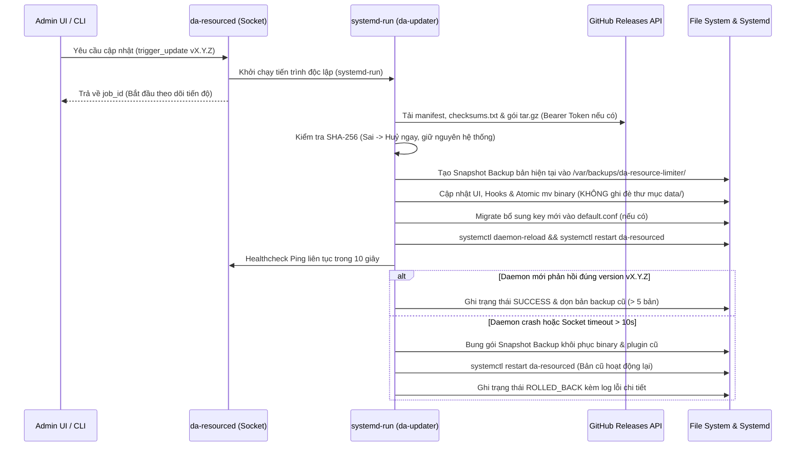

# KẾ HOẠCH PHÁT TRIỂN TỪNG GIAI ĐOẠN & ĐẶC TẢ CẬP NHẬT TỪ GITHUB
**Dự án:** Hệ thống Cô lập và Giới hạn Tài nguyên Đa tầng cho DirectAdmin (`DA-ResourceLimiter`)  
**Phiên bản kế hoạch:** 1.1 (Mở rộng từ Đặc tả Kỹ thuật v1.0)  
**Công nghệ chốt:** Golang (Static Binary Daemon) + PHP/HTML5 (DirectAdmin Evolution Plugin) + Bash (Hooks/Installer) + GitHub Actions/Releases  

---

## 1. ĐỊNH HƯỚNG KỸ THUẬT ĐÃ CHỐT & HIỆU CHỈNH TỪ ĐẶC TẢ GỐC

### 1.1. Các quyết định kiến trúc cốt lõi
1. **Ngôn ngữ phát triển `da-resourced`:** Sử dụng **Golang** biên dịch ra 1 file binary tĩnh duy nhất (`CGO_ENABLED=0`), không phụ thuộc thư viện động trên OS đích (AlmaLinux 8/9, Rocky 8/9, Ubuntu 22.04/24.04), đảm bảo mức tiêu thụ tài nguyên cực thấp (**< 0.5% CPU**, **< 20MB RAM** cho 500 tài khoản hosting).
2. **Cơ chế Update từ GitHub:** Cập nhật thông qua **GitHub Releases**, hỗ trợ linh hoạt cả **Public Repository** và **Private Repository** (xác thực bằng GitHub Personal Access Token / Fine-grained Token cấu hình tuỳ chọn), kiểm tra toàn vẹn mã băm **SHA-256**, tự động **Snapshot Backup & Auto-Rollback** nếu phiên bản mới gặp sự cố khi khởi động.
3. **Bảo toàn dữ liệu cấu hình:** Quá trình cập nhật tách biệt hoàn toàn vùng mã thực thi (`binary`, `admin/`, `user/`, `hooks/`, `scripts/`) khỏi vùng dữ liệu người dùng (`data/users/`, `data/packages/`, `data/default.conf`, `/etc/da-resourced/`).

### 1.2. Sáu (06) điểm hiệu chỉnh kỹ thuật quan trọng bổ sung cho Đặc tả v1.0
Qua rà soát mã mẫu (PoC) trong tài liệu đặc tả v1.0, kế hoạch triển khai bổ sung các chốt chặn kỹ thuật sau để tránh lỗi trên môi trường Production thực tế:

| STT | Vấn đề trong PoC v1.0 | Rủi ro trên Production | Giải pháp chuẩn hóa trong Kế hoạch v1.1 |
| :--- | :--- | :--- | :--- |
| **1** | Chỉ lọc `uid < 1000` khi quét `/proc` tìm PHP-FPM | User hệ thống `nobody` / `nfsnobody` có `UID = 65534` (`>= 1000`) sẽ bị gom nhầm vào slice lạ. | Đối chiếu UID trực tiếp với bảng băm (HashMap) danh sách User thực tế của DirectAdmin đọc từ `/usr/local/directadmin/data/users/` và chặn cứng `uid >= 60000`. |
| **2** | `user-<UID>.slice` chưa tồn tại sau khi Reboot máy chủ | Nếu khách chưa login SSH/Cron mà chỉ có truy cập Web vào PHP-FPM, PAM chưa khởi tạo `user-<UID>.slice`. | Khi `da-resourced` khởi động (hoặc phát hiện PID đầu tiên của user), chủ động gọi Systemd D-Bus / `systemctl start user-<UID>.slice` và tạo `da-php.scope` chuẩn Cgroups v2. |
| **3** | Tách user MySQL bằng `SUBSTRING_INDEX(USER, '_', 1)` | Các tài khoản DirectAdmin chứa dấu `_` (vd migrate từ cPanel: `vina_host` -> DB user `vina_host_wp`) sẽ bị tách sai thành `vina`. | Daemon đối chiếu `PROCESSLIST.USER` bằng thuật toán **Longest-Prefix Match** dựa trên danh sách User thực của DirectAdmin trong RAM (`O(1)` lookup). |
| **4** | Truyền mật khẩu MySQL qua CLI `mysql -u... -p${PASS}` | Lộ mật khẩu `da_admin` trên `/proc/<pid>/cmdline` khi có tiến trình khác quét lệnh. | Daemon Golang đọc `/usr/local/directadmin/conf/mysql.conf` trong bộ nhớ và kết nối trực tiếp qua Unix Socket `/var/lib/mysql/mysql.sock`; Bash script dùng `--defaults-extra-file=/usr/local/directadmin/conf/my.cnf`. |
| **5** | Đặt tên endpoint Ajax là `api.php` / `stats.php` | DirectAdmin tự động chèn HTML Header/Footer của Skin vào output làm hỏng cú pháp JSON trả về. | Sử dụng chuẩn CGI `.raw` của DirectAdmin (`admin/api.raw`, `user/stats.raw`) với quyền `0755` (`diradmin:diradmin`) để trả JSON nguyên bản và kiểm tra biến môi trường `$USERNAME` chống giả mạo. |
| **6** | Ghi đè trực tiếp `/usr/local/directadmin/scripts/custom/user_create_post.sh` | Làm mất các script hook tuỳ chỉnh sẵn có của SysAdmin (như đồng bộ DNS, Firewall, Backup). | Sử dụng kiến trúc **Thư mục con Hook mới của DirectAdmin**: đặt file tại `/usr/local/directadmin/scripts/custom/<hook_name>/da_resource_limiter.sh` để chạy song song an toàn với mọi hook cũ. |

---

## 2. CẤU TRÚC MÃ NGUỒN MONOREPO CHUẨN HÓA

Toàn bộ dự án được quản lý trong một GitHub Repository duy nhất theo cấu trúc sau:

```text
DA-ResourceLimiter/
├── .github/
│   └── workflows/
│       ├── ci.yml                          # Chạy unit test, golangci-lint, shellcheck mỗi khi PR/Push
│       └── release.yml                     # Tự động build đa kiến trúc & tạo GitHub Release khi push tag v*
├── cmd/
│   └── da-resourced/
│       └── main.go                         # Entrypoint của Root Daemon & CLI (serve, apply, update, rollback, status)
├── internal/
│   ├── config/                             # Đọc/ghi cấu hình INI/Key-Value (default, packages, users, updater.conf)
│   ├── dausers/                            # Đồng bộ & cache danh sách DirectAdmin Users <-> Linux UID
│   ├── cgroup/                             # Quản lý systemd user-<UID>.slice, drop-in conf & memory.events OOM reader
│   ├── fpm/                                # Bộ phân loại PID PHP-FPM / lsphp sang user-<UID>.slice/da-php.scope
│   ├── mysqlgov/                           # MariaDB 3-Tier Governor: ALTER USER, PROCESSLIST poller, Kill & Penalty Box
│   ├── ipc/                                # Unix Domain Socket Server (/var/run/da-resourced.sock)
│   ├── logger/                             # Ghi nhật ký vi phạm chuẩn JSONL & log rotation
│   └── updater/                            # GitHub Releases Client (Public/Private Repo, SHA256, Backup & Rollback)
├── plugin/                                 # Nội dung đóng gói vào /usr/local/directadmin/plugins/da_resource_limiter/
│   ├── plugin.conf                         # Metadata khai báo plugin với DirectAdmin
│   ├── admin/
│   │   ├── index.html                      # Giao diện Admin 5 Tabs (tương thích Evolution Skin)
│   │   └── api.raw                         # CGI PHP API xử lý Ajax cho Admin (giao tiếp qua Unix Socket)
│   ├── user/
│   │   ├── index.html                      # Giao diện User xem tài nguyên & lịch sử SQL bị ngắt
│   │   └── stats.raw                       # CGI PHP API chỉ trả dữ liệu của đúng $USERNAME đang đăng nhập
│   ├── hooks/
│   │   ├── admin_img.html                  # Icon & menu item cho Admin
│   │   └── user_img.html                   # Icon & menu item cho User
│   ├── templates/
│   │   └── php-fpm.conf.custom             # Mẫu cấu hình custom PHP-FPM tích hợp biến giới hạn
│   └── data/
│       └── default.conf.example            # Mẫu cấu hình mặc định ban đầu
├── scripts/
│   ├── install.sh                          # 1-Click Installer cho máy chủ mới
│   ├── uninstall.sh                        # Gỡ cài đặt an toàn & khôi phục mặc định
│   ├── update.sh                           # Script thực thi Atomic Swap & Rollback (được gọi qua systemd-run)
│   └── da_hooks/                           # Bộ Event Hooks gắn vào /usr/local/directadmin/scripts/custom/*/
│       ├── user_create_post.sh
│       ├── user_modify_post.sh
│       ├── user_destroy_post.sh
│       ├── database_user_create_post.sh
│       └── package_write_post.sh
├── systemd/
│   └── da-resourced.service                # Unit file cho systemd (Restart=always, OOMScoreAdjust=-900)
├── plan/                                   # Tài liệu đặc tả & kế hoạch phát triển
├── go.mod
└── Makefile                                # Lệnh build nhanh tại local (make build, make package, make test)
```

---

## 3. ĐẶC TẢ PHÂN HỆ MỚI: CẬP NHẬT TỪ GITHUB RELEASES (GITHUB UPDATER)

### 3.1. Kiến trúc Đóng gói trên GitHub Releases
Khi đội ngũ phát triển đẩy Git Tag theo chuẩn Semantic Versioning (ví dụ `v1.2.0`), GitHub Actions (`release.yml`) tự động biên dịch và xuất bản 4 file đính kèm (Release Assets):
1. `da-resource-limiter-linux-amd64.tar.gz` (Chứa binary `da-resourced` + thư mục `plugin/` + `scripts/` + `systemd/`).
2. `da-resource-limiter-linux-arm64.tar.gz` (Hỗ trợ máy chủ ARM64 nếu cần).
3. `checksums.txt` (Chứa mã băm SHA-256 của các gói `.tar.gz` và `manifest.json`).
4. `manifest.json` (Chứa phiên bản, ngày phát hành, `min_mariadb`, tóm tắt `changelog`, cờ `config_schema_version`).

### 3.2. Hỗ trợ đồng thời Public & Private GitHub Repository
* **Lưu trữ cấu hình bảo mật:** Mọi thông số cập nhật được lưu tại `/etc/da-resourced/updater.conf` với phân quyền `chown root:root` và `chmod 0600` (tuyệt đối không đặt trong thư mục plugin của `diradmin` để tránh lộ Token nếu web PHP bị khai thác):
  ```ini
  GITHUB_REPO=shostwp-byte/da-resourcelimiter
  GITHUB_TOKEN=
  UPDATE_CHANNEL=stable
  BACKUP_RETENTION=5
  ```
* **Cơ chế tải thông minh theo loại Repo:**
  * **Khi `GITHUB_TOKEN` rỗng (Public Repo):** Gọi API `https://api.github.com/repos/{owner}/{repo}/releases/latest` (hoặc danh sách `/releases` nếu chọn kênh `beta`) không cần header xác thực, tải gói cài đặt trực tiếp.
  * **Khi có `GITHUB_TOKEN` (Private Repo hoặc tránh giới hạn Rate-Limit 60 req/giờ của GitHub):** Gửi kèm Header `Authorization: Bearer <GITHUB_TOKEN>`. Lưu ý kỹ thuật quan trọng: trên Private Repo, đường dẫn `browser_download_url` thông thường sẽ trả lỗi `404`; do đó module Updater trong Golang sẽ lấy `asset.id` từ JSON Release và tải nhị phân qua endpoint API chuẩn `https://api.github.com/repos/{owner}/{repo}/releases/assets/{asset_id}` kèm Header `Accept: application/octet-stream`.
* **Hiển thị trên Giao diện Admin:** Giao diện chỉ nhận về trạng thái đã che dấu (ví dụ `github_pat_****...8f2a`), cho phép Admin thay đổi Repo/Token và bấm nút **"Test Connection"** để kiểm tra quyền đọc Release ngay lập tức.

### 3.3. Quy trình Cập nhật Nguyên tử (Atomic Update) & Tự động Rollback



* **Giải bài toán "Tự khởi động lại" (Self-Restart Problem):** Nếu tiến trình `da-resourced` tự gọi `systemctl restart da-resourced` bên trong chính nó, `systemd` sẽ gửi tín hiệu `SIGTERM` giết luôn luồng đang chạy cập nhật. Do đó, Daemon uỷ quyền thực thi `scripts/update.sh` sang một **Transient Systemd Service độc lập** (`systemd-run --unit=da-resourced-updater`).
* **Bảo toàn dữ liệu 100%:** Thư mục `/usr/local/directadmin/plugins/da_resource_limiter/data/` (`default.conf`, `packages/*.conf`, `users/*.conf`) và `/etc/da-resourced/` được loại trừ tuyệt đối khỏi thao tác ghi đè. Bộ `migrate_config` chỉ thêm các khoá cấu hình mới (nếu phiên bản mới ra mắt tính năng mới) vào cuối file mà không thay đổi bất kỳ thông số nào khách hàng đang sử dụng.

---

## 4. LỘ TRÌNH PHÁT TRIỂN CHI TIẾT TỪNG GIAI ĐOẠN (6 PHASES)

Tổng thời gian phát triển dự kiến: **4 – 5 tuần** (chia làm 6 giai đoạn kiểm soát chặt chẽ đầu ra).

---

### GIAI ĐOẠN 0: Khởi tạo Kiến trúc Dự án, Môi trường Lab & Khung CI/CD (2 – 3 Ngày)

* **Mục tiêu:** Chuẩn hóa cấu trúc Monorepo, môi trường máy chủ thử nghiệm DirectAdmin và luồng build tự động Golang đa kiến trúc ngay từ ngày đầu.
* **Danh sách công việc:**
  1. Khởi tạo cấu trúc thư mục dự án Golang (`go.mod`), `Makefile`, cấu hình linter (`golangci-lint`, `shellcheck`).
  2. Xây dựng máy chủ Lab chuẩn (AlmaLinux 9 + DirectAdmin + CustomBuild 2.0 PHP-FPM 8.1/8.2 + MariaDB 10.6/10.11 + kích hoạt Cgroups v2 `cgroup2fs`).
  3. Định nghĩa đặc tả giao thức JSON qua Unix Socket (`/var/run/da-resourced.sock`) và định dạng chuẩn của các file `.conf`.
  4. Thiết lập `.github/workflows/ci.yml` kiểm tra biên dịch tự động binary tĩnh (`CGO_ENABLED=0`) cho `linux/amd64` và `linux/arm64`.
* **Sản phẩm bàn giao (Deliverables):** Bộ khung mã nguồn Monorepo, tài liệu đặc tả IPC JSON Schema, máy chủ Lab sẵn sàng.
* **Tiêu chí nghiệm thu (DoD):** Lệnh `make build` xuất ra file binary `da-resourced` chạy độc lập trên AlmaLinux/Ubuntu không báo thiếu bất kỳ thư viện `libc` nào (`ldd` báo `not aitched / statically linked`).

---

### GIAI ĐOẠN 1: Xây dựng Core OS Engine — Cgroups v2 & PHP-FPM Classifier (Tuần 1)

* **Mục tiêu:** Cô lập cứng CPU, Physical RAM (cấm Swap), I/O và số lượng tiến trình (TasksMax) ở tầng Linux Kernel cho toàn bộ tiến trình của từng User (SSH, Cron, PHP-FPM).
* **Danh sách công việc:**
  1. Phát triển package `internal/config` và `internal/dausers`: Đọc cấu hình Package/User và đồng bộ danh sách User thực tế từ `/usr/local/directadmin/data/users/` sang UID (loại bỏ triệt để UID hệ thống `< 1000` và `>= 60000`).
  2. Phát triển package `internal/cgroup`:
     * Sinh/cập nhật/xoá tự động `/etc/systemd/system/user-<UID>.slice.d/50-da-limits.conf` (`CPUQuota`, `MemoryHigh`, `MemoryMax`, `MemorySwapMax=0M`, `IOWeight`, `TasksMax`).
     * Tự động khởi chạy `user-<UID>.slice` khi Daemon khởi động để sẵn sàng đón lưu lượng Web ngay sau khi reboot máy chủ.
     * Tạo scope con `/sys/fs/cgroup/user.slice/user-<UID>.slice/da-php.scope` tuân thủ quy tắc *No Internal Process Constraint* của Cgroups v2.
     * Đọc các chỉ số thời gian thực từ `cpu.stat`, `memory.current`, `pids.current` và bộ đếm `oom_kill` / `high` trong `memory.events`.
  3. Phát triển package `internal/fpm`:
     * Bộ quét nhẹ `/proc` chu kỳ `1s` (kèm tối ưu chỉ đọc các PID mới sinh hoặc thuộc `php-fpm` / `lsphp`), chuyển tức thời worker của khách hàng từ `system.slice` về `user-<UID>.slice/da-php.scope/cgroup.procs`.
  4. Triển khai Custom Template DirectAdmin `/usr/local/directadmin/data/templates/custom/php-fpm.conf` nhận diện biến `DA_PHP_MAX_CHILDREN` và `DA_PHP_MEM_LIMIT`.
* **Sản phẩm bàn giao:** Binary `da-resourced` (v0.2-alpha) hỗ trợ CLI `da-resourced apply <username>`, template `php-fpm.conf.custom`.
* **Tiêu chí nghiệm thu (DoD):** Vượt qua hoàn toàn **TC-01** (khoá cứng CPU PHP-FPM ở ngưỡng `CPUQuota`), **TC-02** (OOM Killer chỉ diệt worker của đúng user vượt `MemoryMax`, master `php-fpm` an toàn) và **TC-03** (chặn đứng Fork Bomb tại `TasksMax`).

---

### GIAI ĐOẠN 2: Xây dựng MariaDB 3-Tier Governor, Penalty Box & IPC Socket (Tuần 2)

* **Mục tiêu:** Kiểm soát chặt CPU/RAM của MariaDB theo từng User mà không làm nghẽn tiến trình `mysqld` dùng chung, đồng thời mở kênh giao tiếp an toàn với Plugin UI.
* **Danh sách công việc:**
  1. Xây dựng công cụ kiểm tra & gợi ý tối ưu Lớp 1 (`/etc/my.cnf`: `performance_schema`, per-thread buffers).
  2. Phát triển Lớp 2 trong `internal/mysqlgov`: Tự động đọc thông tin xác thực từ `/usr/local/directadmin/conf/mysql.conf` trong bộ nhớ, kết nối qua Unix Socket tới MariaDB và áp lệnh `ALTER USER ... WITH MAX_USER_CONNECTIONS ... MAX_STATEMENT_TIME ...` cho mọi DB User thuộc sở hữu của tài khoản hosting.
  3. Phát triển Lớp 3 (`MariaDB Watchdog` chu kỳ `1.5s`):
     * Truy vấn bảng in-memory `information_schema.PROCESSLIST` (`MEMORY_USED`, `TIME_MS`, `INFO`).
     * Ánh xạ `DB_User -> System_User` bằng thuật toán **Longest-Prefix Match** (xử lý chính xác cả username có dấu `_`).
     * Tự động `KILL QUERY <ID>` với truy vấn tiêu tốn nhiều RAM/thời gian nhất khi tổng tài nguyên vượt ngưỡng của User.
  4. Xây dựng cơ chế **Penalty Box (Phạt tự động)**:
     * Theo dõi tần suất vi phạm trong cửa sổ trượt 60 giây; nếu vượt ngưỡng (mặc định 5 lần), tự động hạ `MAX_USER_CONNECTIONS=2`, `MAX_STATEMENT_TIME=2` trong 300 giây và tự động gỡ phạt khi hết hạn.
     * Lưu trạng thái các user đang bị phạt xuống `/var/lib/da-resourced/penalty_state.json` để đảm bảo khôi phục đúng hạn kể cả khi Daemon khởi động lại giữa chừng.
  5. Phát triển `internal/logger` (ghi log vi phạm chuẩn JSONL kèm cơ chế xoay vòng file tránh đầy ổ cứng) và `internal/ipc` (`/var/run/da-resourced.sock`, quyền `root:diradmin 0660`, chống Command Injection).
* **Sản phẩm bàn giao:** Dịch vụ `da-resourced.service` hoàn chỉnh chạy nền ổn định, đầy đủ API qua Unix Socket.
* **Tiêu chí nghiệm thu (DoD):** Vượt qua **TC-04** (`max_statement_time` cắt query chậm chính xác) và **TC-05** (chặn đứng MySQL Memory Flood 15 kết nối song song, kích hoạt và tự gỡ Penalty Box đúng chu kỳ).

---

### GIAI ĐOẠN 3: Tích hợp DirectAdmin Event Hooks & Giao diện Plugin (Tuần 3)

* **Mục tiêu:** Tự động hóa 100% vòng đời tài khoản DirectAdmin và cung cấp giao diện quản trị trực quan trên Evolution Skin cho cả Admin lẫn Khách hàng (User).
* **Danh sách công việc:**
  1. Xây dựng 5 script Event Hooks đặt trong thư mục con an toàn `/usr/local/directadmin/scripts/custom/<hook_name>/da_resource_limiter.sh`:
     * `user_create_post` (gán giới hạn theo Package vừa tạo).
     * `user_modify_post` (đồng bộ khi đổi Package nếu không bật cờ `CUSTOM_OVERRIDE=yes`).
     * `user_destroy_post` (thu hồi `user-<UID>.slice.d`, xoá cấu hình & trạng thái phạt).
     * `database_user_create_post` (áp ngay `ALTER USER` cho DB User mới tạo).
     * `package_write_post` (đồng bộ lại khi Admin thay đổi thông số Hosting Package).
  2. Xây dựng Backend CGI API (`admin/api.raw` & `user/stats.raw`):
     * Xác thực chặt quyền truy cập từ biến môi trường DirectAdmin (`$USERNAME`, phân tách rõ ngữ cảnh Admin và User để User không thể đọc chéo dữ liệu của người khác).
     * Giao tiếp tốc độ cao với `/var/run/da-resourced.sock`.
  3. Phát triển **Giao diện Admin Level (5 Tabs)** tương thích hoàn toàn với Evolution Skin (hỗ trợ Dark/Light mode cơ bản, không xung đột CSS):
     * **Tab 1 — Dashboard & Realtime Monitor:** Top 10 User ngốn CPU, RAM, MySQL Memory; trạng thái Daemon; danh sách User đang trong Penalty Box.
     * **Tab 2 — Package Limits:** Chỉnh sửa giới hạn cho toàn bộ Hosting Package + nút *"Save & Sync All Users in Package"*.
     * **Tab 3 — User Overrides:** Tìm kiếm nhanh theo User/Domain, bật giới hạn riêng (VIP/Abuse), nút *"Reset về mặc định Package"* và nút *"Unblock Penalty"*.
     * **Tab 4 — Violation & OOM Logs:** Tra cứu lịch sử Kernel OOM Kill (từ `memory.events`) và MySQL Killed Queries (hiển thị rõ câu lệnh SQL gây lỗi).
     * **Tab 5 — System & GitHub Update:** Quản lý phiên bản, cấu hình GitHub Repo & Token (ẩn), kiểm tra bản cập nhật mới, xem Changelog, bấm **One-Click Update** hoặc **Rollback**.
  4. Phát triển **Giao diện User Level**:
     * Thanh Progress Bars trực quan (CPU, Physical Memory, Active Processes, MySQL Memory & Connections).
     * Cảnh báo số lần chạm ngưỡng 24h qua và Top 5 câu lệnh SQL chậm/nặng bị ngắt để khách hàng chủ động tối ưu code/index.
* **Sản phẩm bàn giao:** Gói thư mục `/usr/local/directadmin/plugins/da_resource_limiter/` hoàn chỉnh và bộ Hooks tự động.
* **Tiêu chí nghiệm thu (DoD):** Tạo mới User hoặc thêm DB User trên giao diện DirectAdmin tự động áp đặt giới hạn OS + MySQL trong **< 2 giây**; giao diện Admin/User phản hồi mượt (< 200ms/request).

---

### GIAI ĐOẠN 4: Xây dựng Phân hệ GitHub Releases CI/CD & Self-Updater (Nửa đầu Tuần 4)

* **Mục tiêu:** Hoàn thiện khả năng phát hành tự động trên GitHub và cập nhật 1-click an toàn tuyệt đối (kèm Backup & Auto-Rollback) cho cả Public và Private Repository.
* **Danh sách công việc:**
  1. Xây dựng `.github/workflows/release.yml`: Tự động chạy test, cross-compile `da-resourced` (`amd64`/`arm64`) nhúng thông tin `Version`/`Commit`, đóng gói `.tar.gz`, tạo `manifest.json`, băm `checksums.txt` và tạo GitHub Release khi push tag `v*.*.*`.
  2. Phát triển package `internal/updater` trong Golang Daemon:
     * Quản lý file `/etc/da-resourced/updater.conf` (`0600`), hỗ trợ kiểm tra kết nối GitHub API (cả chế độ ẩn danh cho Public Repo và `Bearer Token` + Asset API `application/octet-stream` cho Private Repo).
     * Hàm `CheckUpdate()` so sánh Semantic Version và trả về Changelog.
     * Hỗ trợ lệnh CLI `da-resourced update [--check | --yes | --version vX.Y.Z]` và `da-resourced rollback`.
  3. Viết script `scripts/update.sh` thực thi dưới `systemd-run --unit=da-resourced-updater`:
     * Khoá `flock` chống chạy trùng, kiểm chứng `sha256sum`, tạo Snapshot Backup vào `/var/backups/da-resource-limiter/`, bảo toàn 100% thư mục `data/`, chạy `migrate_config`, hoán đổi nguyên tử binary & UI.
     * Thực hiện **Post-Update Healthcheck (10s)** qua Socket và tự động kích hoạt **Auto-Rollback** nếu Daemon mới gặp lỗi khởi động.
  4. Kết nối đầy đủ luồng hiển thị tiến độ cập nhật thời gian thực lên **Tab 5 (System & GitHub Update)** trên giao diện Admin.
* **Sản phẩm bàn giao:** Pipeline GitHub Actions hoàn chỉnh, Module Updater CLI + Web UI, tính năng Snapshot Rollback.
* **Tiêu chí nghiệm thu (DoD):** Vượt qua hoàn toàn 3 kịch bản kiểm thử mới **TC-06**, **TC-07** và **TC-08** (chi tiết tại Mục 5).

---

### GIAI ĐOẠN 5: Kiểm thử Tải (Stress Test), Đóng gói 1-Click Installer & Bàn giao (Nửa cuối Tuần 4)

* **Mục tiêu:** Đảm bảo độ ổn định cấp độ Production trên máy chủ mật độ cao (300 – 500 tài khoản hosting), tự động hóa cài đặt/gỡ bỏ bằng 1 lệnh duy nhất và hoàn tất tài liệu bàn giao.
* **Danh sách công việc:**
  1. Xây dựng `scripts/install.sh` (kiểm tra hệ điều hành, xác minh Cgroups v2 `cgroup2fs` — hướng dẫn bật GRUB nếu thiếu, kiểm tra phiên bản MariaDB >= 10.5, cài đặt Daemon + Plugin + Hooks, khởi tạo cấu hình mặc định cho toàn bộ User đang tồn tại trên server).
  2. Xây dựng `scripts/uninstall.sh` (dừng Daemon, gỡ bỏ toàn bộ `user-<UID>.slice.d/50-da-limits.conf`, gỡ hooks trong thư mục con mà không chạm tới hook khác của server, khôi phục `MAX_USER_CONNECTIONS` mặc định, tuỳ chọn giữ lại bản sao dữ liệu `data/`).
  3. Thực hiện **Stress Test & Benchmark thực tế**: Giả lập máy chủ 300 – 500 tài khoản hoạt động đồng thời, đo đạc CPU/RAM/File Descriptors của `da-resourced` trong 24 giờ liên tục (cam kết **< 1% CPU**, **< 20MB RAM**, không rò rỉ bộ nhớ / Goroutine leak).
  4. Biên soạn bộ Tài liệu Vận hành (SysAdmin Runbook, Hướng dẫn phát hành bản mới lên GitHub & cấu hình Private Token, Hướng dẫn xử lý sự cố cho đội ngũ Support).
* **Sản phẩm bàn giao:** Bản phát hành chính thức `v1.0.0` trên GitHub Releases, bộ cài 1-click `install.sh`, báo cáo kết quả Stress Test & Tài liệu hướng dẫn vận hành.
* **Tiêu chí nghiệm thu (DoD):** Cài đặt mới hoàn toàn trên máy chủ trắng DirectAdmin chỉ bằng 1 dòng lệnh trong `< 60 giây`; vượt qua trọn vẹn 8/8 kịch bản QA (**TC-01 đến TC-08**).

---

## 5. MA TRẬN KIỂM THỬ NGHIỆM THU MỞ RỘNG (TC-01 → TC-08)

Ngoài 5 kịch bản cốt lõi (**TC-01 đến TC-05**) trong Đặc tả v1.0, đội ngũ QA bắt buộc nghiệm thu thêm 3 kịch bản cho phân hệ GitHub Update & Bảo mật:

| Mã TC | Kịch bản Kiểm thử | Hành vi Kỳ vọng của Hệ thống |
| :--- | :--- | :--- |
| **TC-01** | **PHP CPU Spike** (`while(true)` trên 10 tab, gói `CPUQuota=100%`) | Tổng CPU của toàn bộ worker `php-fpm` thuộc user đó bị khoá cứng ở mức `100%` (1 vCore), không ảnh hưởng core khác. |
| **TC-02** | **PHP/Cron Memory Leak** (cấp phát vượt `MemoryMax=1024M`) | Tiến trình vi phạm bị Kernel OOM Killer tiêu diệt ngay mốc 1024MB; bộ đếm `oom_kill` tăng lên và hiển thị trên UI; master `php-fpm` an toàn. |
| **TC-03** | **SSH / Cron Fork Bomb** (`:(){ :|:& };:` với `TasksMax=100`) | Bị chặn đứng tức thì khi tổng tiến trình/luồng chạm mốc 100. |
| **TC-04** | **MySQL Slow Query** (chạy câu lệnh SQL nặng quá `10s`) | MariaDB tự ngắt câu lệnh đúng giây thứ 10 (`max_statement_time exceeded`). |
| **TC-05** | **MySQL Memory Flood & Penalty Box** (15 kết nối ngốn tổng 450MB > giới hạn 256MB, lặp lại liên tục) | Daemon tự động `KILL QUERY` luồng nặng nhất, ghi log SQL vi phạm, sau 5 lần trong 60s tự động đưa user vào Penalty Box 300s rồi tự khôi phục. |
| **TC-06** | **GitHub Update (Public & Private Repo) + Bảo toàn dữ liệu** | Cấu hình Private Repo kèm Token trên Tab 5 -> Bấm One-Click Update từ `v1.0.0` lên `v1.0.1` -> Cập nhật thành công cả Daemon & UI, giữ nguyên 100% cấu hình riêng trong `data/users/` và `data/packages/`. |
| **TC-07** | **Chống Gói Cập nhật Giả mạo / Hỏng (Corrupted SHA-256)** | Giả lập gói `.tar.gz` tải về khác mã băm trong `checksums.txt` -> Updater từ chối giải nén ngay lập tức, giữ nguyên phiên bản đang chạy và báo lỗi rõ ràng trên Admin UI. |
| **TC-08** | **Tự động Rollback khi Bản mới Lỗi Khởi động (Faulty Release)** | Phát hành thử bản `v1.0.2-broken` cố tình trả mã lỗi `exit(1)` khi khởi chạy -> Sau 10s Healthcheck thất bại, `update.sh` tự động khôi phục bản `v1.0.1` từ Snapshot Backup, `da-resourced` xanh trở lại mà không cần can thiệp tay. |

---

## 6. QUẢN TRỊ RỦI RO & PHƯƠNG ÁN DỰ PHÒNG

1. **Máy chủ cũ chưa bật Cgroups v2 (đang chạy Cgroups v1 trên AlmaLinux 8 cũ):**
   * *Phương án:* `install.sh` tự động phát hiện qua `stat -fc %T /sys/fs/cgroup/`. Nếu chưa phải `cgroup2fs`, script dừng cài đặt an toàn và xuất sẵn lệnh chuẩn (`grubby --update-kernel=ALL --args="systemd.unified_cgroup_hierarchy=1"`) để SysAdmin chủ động lên lịch reboot bảo trì.
2. **Máy chủ sử dụng MySQL 8.0 thay vì MariaDB 10.5+:**
   * *Phương án:* MySQL 8.0 sử dụng `MAX_EXECUTION_TIME` (tính bằng ms) thay vì `MAX_STATEMENT_TIME` và cấu trúc đo RAM luồng nằm trong `performance_schema` thay vì `information_schema.PROCESSLIST.MEMORY_USED`. Trong Giai đoạn 2, `install.sh` và `mysqlgov` sẽ kiểm tra rõ biến `VERSION()` của DB để cảnh báo yêu cầu MariaDB 10.5+ (và thiết kế sẵn interface `DBDriver` trong Golang để dễ dàng mở rộng sang MySQL 8.0 ở phiên bản `v1.x` tiếp theo nếu cần).
3. **Giới hạn API Rate-Limit của GitHub trên dải IP dùng chung:**
   * *Phương án:* Đối với Public Repo không điền Token, GitHub giới hạn 60 request/giờ/IP. Daemon sẽ cache kết quả `CheckUpdate` trong 15 phút và cho phép nhập một Read-only Token ngay cả với Public Repo để nâng hạn mức lên 5.000 request/giờ.
